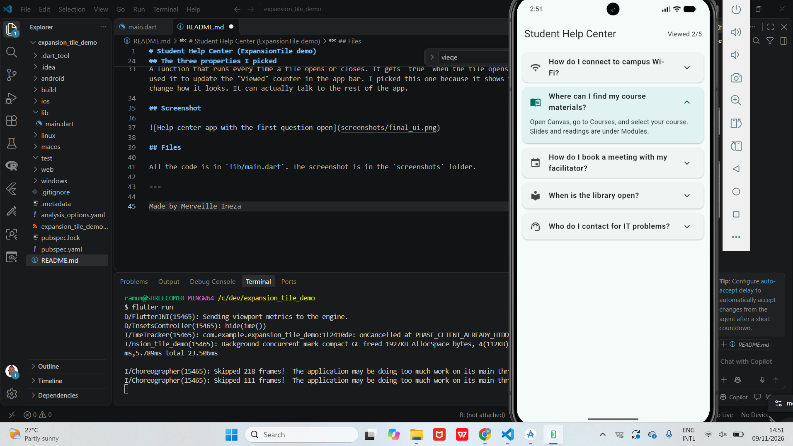

# Student Help Center (ExpansionTile demo)

A small Flutter app I built to show how `ExpansionTile` works: tap a row and it opens up to show more content, tap it again and it closes.

## What the app does

It's a help center for students. Each common question (Wi-Fi, Canvas, library hours and so on) is a tile, and tapping it shows the answer. I went with an FAQ because that's where you see this widget most in real apps. It keeps a long list of questions short until you actually need an answer.

There's also a small counter in the top right that shows how many questions you've opened.

## How to run it

1. Download or clone this repo.
2. Open the folder in VS Code.
3. In the terminal, run `flutter pub get`.
4. Then run `flutter run` and pick a device (emulator, phone or Chrome).

## The three properties I picked

**initiallyExpanded**
Decides whether a tile is already open when the screen loads. I set it so only the first question starts open, which means the user sees an answer straight away without tapping anything.

**backgroundColor**
The color of the tile while it's open. I used a light teal so it's obvious which answer you're reading, especially when a few tiles are open at once. If you want to color the closed tiles too, that's a separate property called `collapsedBackgroundColor`.

**onExpansionChanged**
A function that runs every time a tile opens or closes. It gets `true` when the tile opens and `false` when it closes. I used it to update the "Viewed" counter in the app bar. I picked this one because it shows the widget can do more than change how it looks. It can actually talk to the rest of the app.

## Screenshot

## Files

All the code is in `lib/main.dart`. The screenshot is in the `screenshoots` folder.

---

Made by Merveille Ineza 